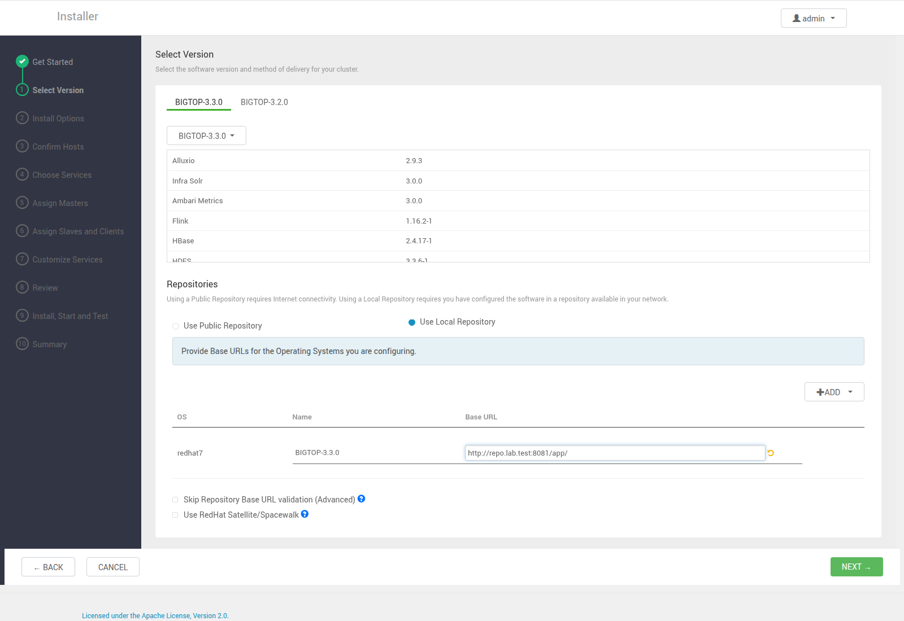
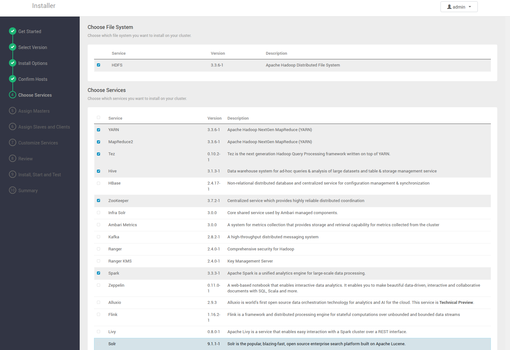

# 从 Ambari Web 安装 BIGTOP 3.3.0

适用于使用本交付包新建 CentOS 7.9 x86_64 集群。先由部署脚本安装 Ambari Server、Agent 和管理库，再由浏览器向导创建集群、安装和启动数据服务。节点数量取决于现场主机清单。本文中的域名、目录、容量、数据库名和服务角色分布均需按现场规划填写。

## 进入向导前

**验收进度**　三台 CentOS 7.9 x86_64 容器已通过本地仓库校验、手工注册和主机确认。Chromium 选中七项服务、分配主从角色、核对账号，并对外部 PostgreSQL 执行了 TLS 连接测试。通过 **Review** 后，Ambari 创建了 `Install Services` 请求，页面显示正在安装 DataNode。最终启动结果见下方验收说明。[浏览器及后台任务记录](https://github.com/wenna/ambari-bigtop-centos7-build-public/actions/runs/44769937053)

1. 按 [管理面安装手册](AMBARI.zh-CN.md) 第 1、2 节校验交付文件、准备 FQDN 和正反向解析、SSH、时钟、数据盘、服务账号、防火墙、Java 版本和数据库。运行 `bash ops/deploy-cluster.sh /etc/bigtop-deploy/site.env ambari`，确认清单里的每个 Agent 都已注册为 `HEALTHY`。在新建集群前保留这份主机清单。
2. 将包中 `yum-staging/` 和 `runtime-repo/` 的完整目录分别发布到内网应用仓库和系统依赖仓库。应用仓库的根目录必须直接包含 `repodata/repomd.xml`。系统依赖仓库需在每台机器上启用并配置交付的 CentOS/EPEL 公钥。逐台核对 `yum repolist enabled`，确认软件来自预期仓库。
3. 从 **Ambari Server 和每台 Agent** 检查仓库能访问。以下变量替换为现场地址。此命令只读取仓库元数据。

   ```bash
   APP_REPO=https://yum.example.internal/bigtop/3.3.0/el7/x86_64
   OS_REPO=https://yum.example.internal/runtime/el7/x86_64
   for url in "$APP_REPO" "$OS_REPO"; do
     curl --fail --silent --show-error "${url%/}/repodata/repomd.xml" -o /dev/null || exit 1
   done
   ```

4. 准备独立的 Hive Metastore PostgreSQL 数据库、库所有者和密码。将数据库 CA 部署到访问数据库的主机，将本包提供的 pgJDBC 部署到交付指定位置。记录证书覆盖的数据库域名、端口、库名、驱动类和 CA 路径。确认数据库允许 Hive 服务主机通过 TLS 登录。
5. 将现场参数表放在手边：集群名、节点 FQDN、角色分布、HDFS/YARN 目录、队列资源、堆内存、Hive JDBC 地址、服务账号和组。Web 向导需要在页面中填写这些值。已有集群请从其管理页面进入相应操作，勿重复建群。

## 创建集群与分配角色

1. 用管理员账号登录管理网内的 Ambari Web，选择 **Launch Install Wizard**，填写集群名。
2. 在 **Select Version** 选择 **BIGTOP-3.3.0** 和 **Use Local Repository**。本次集群全部使用 CentOS 7 时，仅保留 **redhat7** 行，在 **Base URL** 填内网应用仓库根地址。后续按服务选项安装 RPM。

   将鼠标移到其他操作系统行上，点击该行的 **Remove**。保留仓库校验，单击 **Next**。截图中的 URL 为容器内网示例，生产使用现场地址。

   

3. 在 **Install Options** 填写本次要纳管的完整 FQDN，每行一台，选择手工注册方式。管理面安装阶段已启动各 Agent，此处可复用其心跳。在 **Confirm Hosts** 核对主机名和注册结果，查看告警详情，解决解析、磁盘或依赖问题后再继续。
4. 在 **Choose Services** 选 HDFS、YARN 与 MapReduce2、ZooKeeper、Tez、Hive 和 Spark。在 **Assign Masters** 按规划指定 NameNode、Secondary NameNode、ResourceManager、History Server、Hive Metastore、HiveServer2、Spark History Server 和 ZooKeeper Server。ZooKeeper 选择分布于独立故障域的奇数个成员。
5. 在 **Assign Slaves and Clients** 核对每台主机的 DataNode、NodeManager 和客户端角色。生产节点按数据盘、计算资源和网关用途分配；三节点验收的角色密度不适合直接照搬到 20–100 台。

   **单 nameservice 集群请在 Router 列点击 none。** 三节点向导默认给一台机器勾选了 Router。实测该任务因本包的 stack-select 无法识别 `hadoop-hdfs-dfsrouter` 而失败。Router 用于 HDFS Federation，本手册的普通 HDFS 与 NameNode HA 均无需分配此角色。[失败任务记录](https://github.com/wenna/ambari-bigtop-centos7-build-public/actions/runs/44771313375)

选择上述服务后会出现 **Limited Functionality Warning**，提示省略 Ambari Metrics 将无法在 Ambari 查看相应指标。接受该范围时点击 **Proceed Anyway**。



## 配置、下发与验收

1. 在 **Customize Services** 填写 Hive 数据库用户和密码，选择 **Existing PostgreSQL**，复核库名、用户、驱动类 `org.postgresql.Driver` 和 JDBC URL。示例为 `jdbc:postgresql://pg.example.internal:5432/hive?sslmode=verify-full&sslrootcert=/etc/pki/bigtop/ca.crt`。用 **Test Connection** 检查实际连通性。密码仅填入受控页面。
2. 核对 DataNode 数据目录、NameNode 元数据目录、NodeManager 本地盘和日志盘、YARN 内存与 vCore、各服务运行账号和组，以及 Tez 归档路径。每个目录应位于对应角色的预期挂载点。根据现场容量解决校验告警，复核配置后进入 **Review**。
3. 在 **Review** 对照清单核对服务、主机、仓库和数据库，再提交安装。在 **Install, Start and Test** 展开每台主机的任务；记录失败任务的主机名、组件和首个错误。处理依赖、权限或配置后从界面重试。出现失败或仅部分启动时，保留当前请求记录和数据目录。
4. 在 **Summary** 完成向导，进入服务页和后台操作，核对服务进程为 `STARTED`，客户端为 `INSTALLED`。逐项运行服务检查，提交现场 YARN、Hive on Tez 和 Spark on YARN 作业并核对输出。需高可用时另行完成 NameNode 和 ResourceManager 的 HA 配置及切换验收；首次安装完成并不代表 HA 已生效。

**验收说明**　当前浏览器记录覆盖至安装请求下发，仍需核对全部服务成功启动及 Summary。生产验收请以现场后台任务和组件状态为准。
